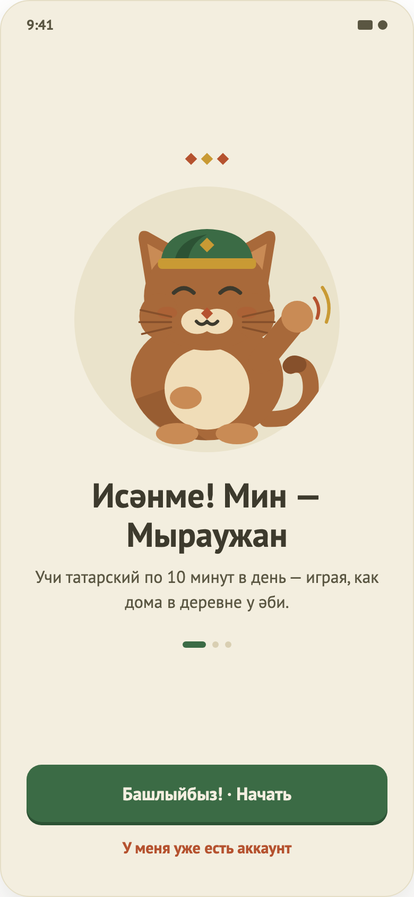

# 01. Онбординг

> Макет `01.png` устарел: в нём ещё есть три ромба над картинкой и прежние кнопки. Актуальное поведение описано ниже.

## Назначение
Первое знакомство: тремя слайдами объяснить, чем полезно приложение, и отправить пользователя ко входу или регистрации. Показывается только при первом запуске.

## Откуда и куда
- **Откуда:** запуск приложения, если пользователь не вошёл и онбординг ещё не показывали.
- **Куда:** «Начать учиться» на последнем слайде → Регистрация; «Пропустить» или «✕» → Вход. После любого выхода онбординг больше не показывается.

## Что на экране
1. Сверху: стрелка «назад» (со второго слайда) и крестик «закрыть».
2. Слайд: маскот в круге, заголовок, подзаголовок. Слайды листаются свайпом или кнопкой.
3. Индикатор страниц (его положение не зависит от высоты текста).
4. Большая кнопка: «Далее», на последнем слайде «Начать учиться».
5. Ссылка «Пропустить».

## Тексты слайдов
1. «Исәнме! Я — Мыраужан» — «Помогу заговорить по-татарски: с семьёй, друзьями и дома».
2. «10 минут в день — и слова запоминаются» — «Короткие уроки: слушай, говори и собирай фразы. Без зубрёжки и скучных правил».
3. «Первые фразы — уже на этой неделе» — «Копи опыт, не прерывай серию дней и открывай новые темы. Я буду рядом».

Тексты не проверены носителем языка.

## Поведение
- «Далее» и свайп переключают слайд, «назад» возвращает на предыдущий. Системная кнопка «Назад» на Android тоже возвращает на предыдущий слайд.
- «Начать учиться» (последний слайд) ведёт к регистрации.
- «Пропустить» и «✕» ведут ко входу с любого слайда.

## Состояния
Только основной: загрузки и ошибок нет.

## Ограничения
- Слайды 2 и 3 отсутствуют в макете; нужны дизайн и вычитка текстов.
- Подпись кнопки меняется без анимации.
- Если закрыть приложение, не выйдя из онбординга, он покажется снова.
- После онбординга сразу идёт регистрация; пробного урока без регистрации нет.
