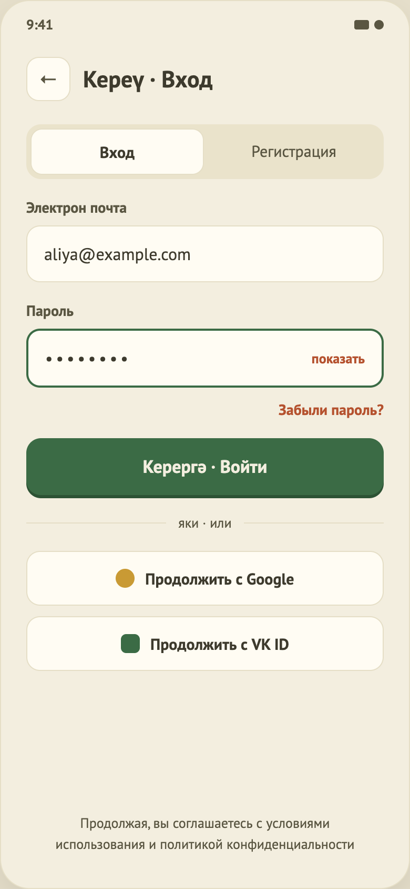

# 02. Вход / Регистрация

## Назначение
Войти или создать аккаунт по e-mail и паролю (либо через Google / VK ID), после чего попасть на главную.

## Откуда и куда
- **Откуда:** из онбординга (режим зависит от нажатой кнопки) или сразу при запуске, если онбординг уже показывали (режим «Вход»).
- **Куда:** успех → Главная, вернуться назад на этот экран нельзя. Кнопки «назад» на экране нет; системный «назад» на Android возвращает на онбординг, если пользователь пришёл оттуда.

## Что на экране
1. Заголовок («Кереү · Вход» или «Теркәлү · Регистрация»).
2. Переключатель «Вход | Регистрация».
3. Поле «Электрон почта».
4. Поле «Пароль» со ссылкой «показать/скрыть».
5. «Забыли пароль?» — только в режиме входа.
6. Главная кнопка («Керергә · Войти» / «Теркәлергә · Зарегистрироваться»).
7. Уведомление об ошибке запроса (если есть, вид «Ошибка», сверху).
8. Разделитель «яки · или» и кнопки «Продолжить с Google», «Продолжить с VK ID».
9. Юридическая сноска.
10. Уведомление (по событию, см. «Поведение»); макет: `design/screens/12.png`.

## Поведение
- **Переключение режима:** меняются заголовок и текст кнопки, ошибки сбрасываются, введённые e-mail и пароль сохраняются.
- **Ввод:** при редактировании поля его ошибка исчезает.
- **Клавиатура:** в поле почты кнопка «Далее» переводит на пароль; адрес не исправляется автоматически и не начинается с заглавной буквы. В поле пароля кнопка «Готово» закрывает клавиатуру и отправляет форму так же, как главная кнопка.
- **Проверка перед отправкой:**
  - e-mail пуст → «Введите электронную почту»;
  - e-mail не похож на адрес → «Проверьте адрес…»;
  - пароль пуст (вход и регистрация) → «Введите пароль»;
  - пароль короче 6 символов (только при регистрации) → «Пароль — не меньше 6 символов». При входе длина не проверяется: у существующего аккаунта пароль мог быть создан по другому правилу.
  Проверка намеренно простая, полная проверка — на сервере. При ошибках запрос не отправляется.
- **Отправка:** пока идёт запрос, кнопка показывает вращающийся индикатор вместо подписи, остаётся зелёной, и повторное нажатие игнорируется. При успехе — переход на главную.
- **Ошибка запроса:** показывается уведомлением сверху на 5 секунд (закрывается крестиком или свайпом вверх). Текст зависит от режима: «Не получилось войти…» или «Не получилось зарегистрироваться…». При ошибках сети (`NET_TIMEOUT`, `NET_ERROR`) добавляется «Проверьте интернет и попробуйте ещё раз», для остальных — «Код ошибки: …». Начало новой отправки скрывает прежнее уведомление.
- **Google / VK ID:** пока заглушка. Нажатие показывает уведомление «Вход через Google и VK ID пока недоступен» (сверху, поверх шапки). Оно исчезает через 5 секунд, закрывается крестиком или свайпом вверх; повторное нажатие заменяет его и перезапускает таймер. Вход при этом не выполняется.
- **«Забыли пароль?»:** пока заглушка. Нажатие показывает уведомление «Восстановление пароля пока недоступно» (так же, как у входа через Google и VK ID).

## Тестовый режим (вместо сервера)
Принимаются любые e-mail и пароль (и для входа, и для регистрации). Имя пользователя берётся из части e-mail до «@» с заглавной буквы. Сессия сохраняется между запусками.

## Состояния
Чистая форма · ошибка поля (текст под полем) · отправка (кнопка с индикатором) · ошибка запроса (уведомление сверху).

## Ограничения
- Нет реального сервера и входа через соцсети; пароль нигде не проверяется.
- Восстановление пароля — заглушка; нет проверки «пользователь уже существует» и согласия с условиями (сноска без ссылок).
- Поля подтверждения пароля нет осознанно: опечатку можно поймать ссылкой «показать».
- Нет разных текстов для неверных данных и занятого e-mail (серверных кодов авторизации пока нет).
- В интерфейсе нет выхода из аккаунта.
- Для ошибок полей нет оформления в макете (требуется дизайн).
