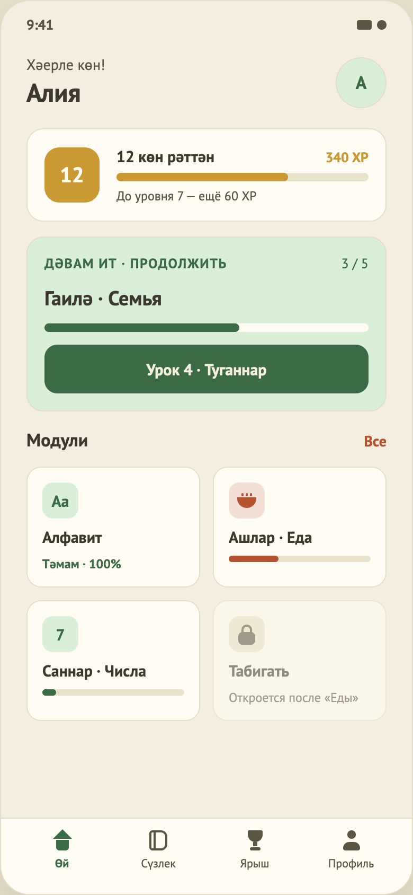

# 03. Главная

## Назначение
Центр приложения: приветствие, серия и XP, карточка «продолжить урок», список модулей, нижнее меню.

## Откуда и куда
- **Откуда:** запуск приложения с активной сессией; успешный вход; «Продолжить» на экране результата.
- **Куда:** «Урок N · …» → Урок.

## Что на экране (сверху вниз, прокручивается)
1. **Шапка:** «Хәерле көн!», имя из профиля, круглый аватар (цвет с буквой имени или поза Мыраужана); нажатие на аватар открывает вкладку «Профиль».
2. **Главная карточка** — главное действие экрана; форма и место постоянны, меняются тег, заголовок и кнопка:
   - **Новичок** (ни одного пройденного и начатого урока, макет 34): «Башларга · Начать», название первого модуля, число уроков («3 урока»), Мыраужан, без полосы, кнопка «Урок 1 · …».
   - **Продолжение** (макет 03): «Дәвам ит · Продолжить», тема модуля, «3 / 5», полоса, кнопка «Урок 4 · …». Если урок начат, но не пройден: подпись «Начнём урок с начала» (шаги внутри урока не сохраняются; макет 37).
   - **Новый модуль** (макет 35): «Яңа модуль · Новый модуль», три ромба, число уроков, кнопка на первый урок нового модуля.
   - **Всё пройдено** (макет 36): «Тәмам · Готово», «Все модули пройдены», Мыраужан, кнопка «Повторить урок N» (последний урок курса).
3. **Компактная карточка серии:** «Серия: N көн», «Ур. L · N XP» и тонкая полоса прогресса до следующего уровня. У новичка вместо неё приглашение «Пройди урок и начни серию» с контурным ромбом (нулевая серия выглядела бы упрёком), первый модуль подсвечен рамкой.
4. **«Модули»** и ссылка «Все».
5. **Плитки модулей** в две колонки.
6. **Нижнее меню:** Өй, Сүзлек, Ярыш, Профиль.

## Поведение
- **Загрузка:** при открытии показывается экран загрузки; при сбое — экран ошибки с кнопкой «Повторить».
- **Имя** берётся из сессии, аватар — первая буква имени.
- **Серия и XP** обновляются сразу после занятий, без перезагрузки экрана.
- **Карточка урока:** полоса показывает долю выполненных шагов; кнопка запускает урок.
- **Плитки модулей** бывают трёх видов:
  - *закрыт* — светлая бежевая плитка с замком, только татарское название и подсказка у каждого закрытого модуля («Откроется после модуля «Ашлар · Еда»»: название нужного модуля так, как оно написано на его плитке);
  - *пройден* (100 %) — подпись «Тәмам · 100%»;
  - *в процессе* — полоса прогресса.
  На плитке иконка модуля и название «татарское · русское».
- **Нажатие на плитку модуля** (открытый или закрытый) открывает [экран модуля](18-module.md). **На «Все»** показывает уведомление «пока недоступно» (экрана нет). **«Сүзлек», «Ярыш», «Профиль»** открывают [заглушку раздела](16-coming-soon.md). Уведомление исчезает через 5 секунд, закрывается крестиком или свайпом вверх.
- **Нижнее меню:** на главной активна «Өй»; остальные вкладки ведут на заглушку (экран 16), нижнее меню остаётся на экране.

## Тестовые данные
Каталог `modules.json`: Алфавит (уроки 1–2), Ашлар/Еда (3, 4 «Туганнар / Семья»), Саннар/Числа (5–6), Табигать/Природа (7–8, закрыта, пока не пройдена «Еда»). Задания уроков кроме 4-го — временные копии (`TODO(content)`). Новый пользователь видит «Урок 1», открыт только первый модуль.

## Состояния
Загрузка · основной · ошибка (кнопки «Офлайн-режим» нет).

## Анимация прогресса после урока
После засчитанного урока, когда пользователь возвращается на главную, один раз проигрывается «доезд» (макеты 39 и 40): через 0,3 с полоса карточки «Продолжить» и полоса плитки модуля плавно растут за 0,7 с, счётчик «2 / 5» меняется на «3 / 5», вокруг карточки и плитки на 0,6 с вспыхивает золотое кольцо, над карточкой всплывает «+1 урок» и гаснет. Нажатия не блокируются, анимация короткая (около 2,3 с). Если урок не засчитан, ничего не растёт и ничего не проигрывается. При системной настройке «уменьшить анимацию» итог показывается сразу, а подсветка просто держится секунду. После перезапуска приложения анимации нет.

## Ограничения
- Состояния «всё пройдено» нет в макете: после последнего урока карточка показывает последний урок (`TODO(design)`).
- Счётчик на карточке «Продолжить» («1 / 2») — пройденные уроки текущего модуля, а не задания.
- Нет экранов модуля, всех модулей; словарь, соревнования и профиль — заглушки.
- Приветствие не зависит от времени суток.
- Нет обновления свайпом вниз.
- Нижнее меню и ссылка «Все» нарисованы упрощённо (требуется дизайн).

## Новая главная: роад-мап модулей (макет от 04.11.2026, реализована в коде 04.11.2026; прежние разделы про карточку «Продолжить», серию и сетку 2×2 выше устарели)
Решения владельца и ролей: `21-course-roadmap.md`, раздел 6; анимации: `design/home-animations.md`; макеты 03 (текущий модуль 3), 45 (старт курса), 46 (текущий 6), 47 (текущий 9), 48 (курс пройден), 49 (прокрутка с плавающей кнопкой), длинная лента `design/screens/home-roadmap-full.png`.
- Вместо сетки 2×2 вертикальная прокручиваемая лента из всех модулей: плитки по две в ряд, порядок слева направо, тропа из ромбов; текущий модуль это раскрытая карточка с иллюстрацией, эчпочмаками по числу уроков, кнопкой «Урок N · название» и Мыраужаном. Карточка «Продолжить» и ссылка «Все» убраны.
- Пройденный модуль: цветная иллюстрация, печать «Тәмам», номер; закрытый: силуэт, замок, «Откроется после «…»», тап даёт подсказку. Пустой эчпочмак: контур `#8A8468`.
- При открытии лента сама прокручивается к карточке текущего модуля; когда карточка ушла за экран, внизу плавающая кнопка «Урок N» со стрелкой к карточке. Серия и XP это чип в шапке. Курс пройден: праздничная карточка и кнопка «Кабатлау · Повторить слова» (экрана повторения пока нет).
- Фиксированная сетка (решено 04.11.2026): нечётные модули слева, чётные справа, у каждого постоянное место; карточка текущего раскрывается на своём ряду, соседние плитки при смене текущего не переезжают (проверено кадрами «до/после» 3→4). Автопрокрутка: кнопка урока в карточке целиком видна над меню (проверено на 320×568). Плавающая панель «Урок N» показывается, пока кнопка урока не видна (с гистерезисом), у стрелки подпись «К текущему модулю». «Откроется после «…»» только у ближайшего закрытого модуля. Тропа строится по границам плиток.
- Открыто: подписи для скринридера в коде, поведение при 14 модулях (LazyColumn, тропа кусочками), тёмная тема, экран повторения слов (куда ведёт «Кабатлау»); все татарские надписи: needs native-speaker review.
