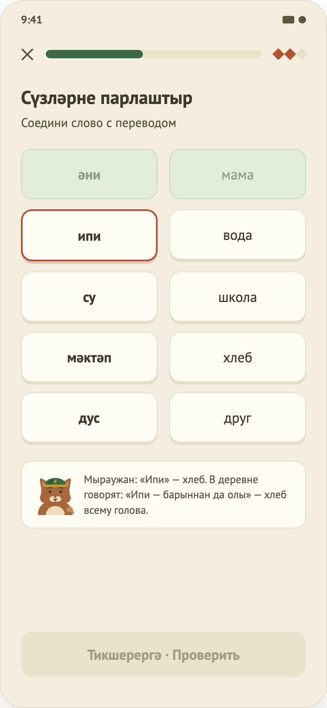

# 04. Урок: общая механика + «Сопоставление»

> Часть A описывает механику, общую для **всех упражнений**; документы 05, 09, 10, 11 на неё ссылаются.

# Часть A. Общая механика урока

## Назначение
Провести пользователя через урок шаг за шагом: проверка ответов, XP, итог.

## Откуда и куда
- **Откуда:** Главная (весь урок) или Результат «Повторить ошибки» (только ошибочные шаги).
- **Куда:** после последнего шага → Результат. Закрытие с подтверждением → предыдущий экран.

## Состав урока
Порядок упражнений: **сопоставление → квизы → аудирования → сборка предложений → письменные переводы**. Урок «Семья» — 12 шагов: 1 + 4 + 2 + 2 + 3. В режиме «повторить ошибки» остаются только указанные шаги. Если шагов нет — экран ошибки.

## Что на экране
1. **Верх:** кнопка ✕ и полоса прогресса урока.
2. **Задание** (прокручивается). Смена шага сопровождается плавным появлением нового.
3. **Низ:** кнопка «Тикшерергә · Проверить» (неактивна, пока нет ответа). После проверки — панель результата:
   - верно: зелёная «Дөрес! · Верно!», пояснение, кнопка «Дәвам итәргә»;
   - неверно: терракотовая «Ялгыш · Ошибка», «Правильный ответ: …», кнопка «Аңладым · Понятно».

Полоса прогресса считает шаг пройденным после его проверки.

## Правила
| Ситуация | Что происходит |
|---|---|
| Загрузка урока | Экран загрузки; при сбое — экран ошибки с «Повторить». Запускается отсчёт времени урока. |
| Проверка шага | Определяется верно/неверно, показывается панель, результат шага и XP (3 за верный) сохраняются, обновляется серия дней, урок получает статус «в процессе». |
| Неверный ответ | Шаг попадает в список ошибок. |
| «Продолжить» | Если шаги остались — следующий шаг. Иначе — завершение. |
| Завершение | Считается точность и время. Если точность не ниже 80 % — урок отмечается пройденным. Открывается Результат. |
| Закрытие (✕ или «Назад») | Диалог «Выйти из урока?» — «Выйти» / «Остаться». Предупреждает, что проверенные ответы и XP сохранятся. «Выйти» возвращает назад без Результата. |
| Звук | Воспроизведение обычное или замедленное. Останавливается при проверке шага и выходе. Если у задания нет записи — имитация воспроизведения 1,2 с без звука. |

## Когда кнопка «Проверить» активна
Выбран вариант (квиз, аудирование); собрано нужное число слов (сборка); введён непустой текст (перевод). У «Сопоставления» кнопки нет.

---

# Часть B. Упражнение «Сопоставление»

## Назначение
Соединить татарские слова с русскими переводами.

## Что на экране
Заголовок «Сүзләрне парлаштыр», подпись «Соедини слово с переводом». Две колонки по 5 плиток: слева татарские слова, справа переводы в перемешанном порядке (порядок всегда одинаков и не совпадает с левым). Под плитками — подсказка маскота, если она есть для выбранного слова.

## Поведение
- **Выбор слова слева:** плитка выделяется зелёной рамкой (терракота зарезервирована за ошибкой); повторное нажатие снимает выделение. Уже сопоставленные плитки недоступны.
- **Выбор перевода справа:** работает, только если слово слева выбрано.
  - Верная пара — обе плитки становятся светло-зелёными с галочкой, текст остаётся читаемым.
  - Неверная — обе плитки на 0,7 с краснеют, число ошибок шага растёт.
- **Завершение шага:** когда все пары найдены, шаг засчитывается сразу и показывается панель «Верно». Шаг считается верным (с XP) только если за него **не было ни одной ошибки**; иначе он попадает в ошибки, XP 0.
- **Подсказка маскота:** для некоторых слов («ипи») при выборе появляется пояснение. Картинки маскота нет.
- Кнопка «Проверить» не нужна: шаг завершается, как только найдены все пары.

## Ограничения
- Нет картинки маскота у подсказки и звука при выборе слова.
- Контент не проверен носителем.
- XP не зависит от числа ошибок: шаг либо верный, либо нет.
