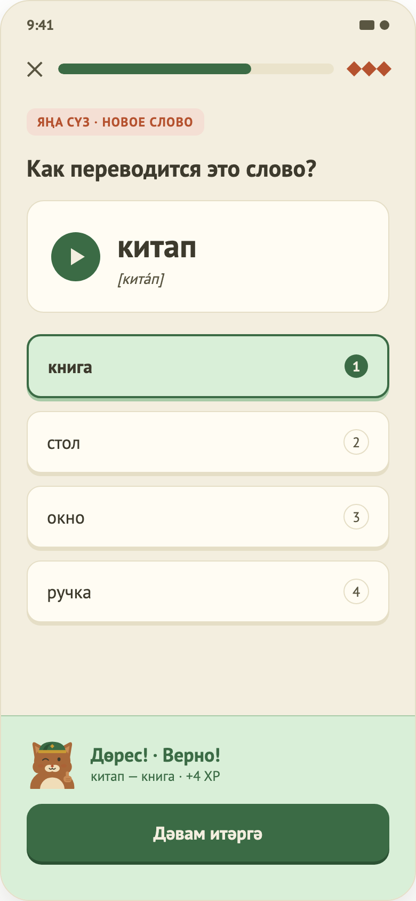

# 05. Упражнение «Квиз»

Общая механика (XP, проверка, выход) — в [04-lesson-matching.md](04-lesson-matching.md), часть A.

## Назначение
Показать татарское слово и выбрать правильный русский перевод.

## Что на экране
1. Тег «Яңа сүз · новое слово» — только если слово новое.
2. Заголовок «Как переводится это слово?».
3. Карточка слова: кнопка прослушивания, слово, транскрипция (если есть).
4. Варианты ответа, пронумерованные 1, 2, 3…
5. Кнопка «Проверить» / панель результата.

## Поведение
- Пользователь выбирает вариант; до проверки выбор можно менять. «Проверить» активна, когда вариант выбран. После проверки варианты блокируются.
- **Верно:** вариант зелёный, пояснение «слово — перевод» и «+3 XP».
- **Неверно:** выбранный вариант красный, правильный зелёный, «Правильный ответ: …», шаг попадает в ошибки.
- **Прослушивание:** кнопка звука показывается, только если у слова есть запись (`audioUrl`); сейчас записей нет, поэтому кнопки на экране нет (`TODO(audio)`).

## Данные
Каждый вопрос: слово, транскрипция, варианты, номер правильного, признак «новое слово». В уроке «Семья» — 4 вопроса.

## Ограничения
- Нет аудиозаписей.
- Варианты не перемешиваются (порядок задан в контенте).
- Транскрипции не проверены носителем.
