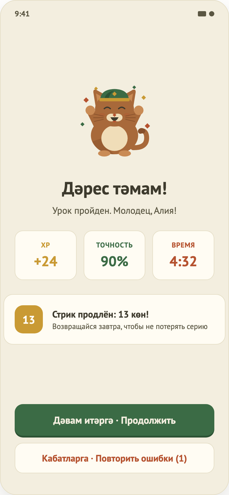

# 06. Результат урока

## Назначение
Подвести итог урока (XP, точность, время, серия) и предложить продолжить или повторить ошибки.

## Откуда и куда
- **Откуда:** из урока; все цифры передаются готовыми.
- **Куда:** «Продолжить» → Главная; «Повторить ошибки (N)» → новый урок только из ошибочных шагов.

## Что на экране
1. «Дәрес тәмам!» и «Урок пройден. Молодец, {имя}!» (без имени — «друг»).
2. Три плитки: **XP** (+N), **Точность** (N %), **Время** (м:сс).
3. Карточка «Стрик продлён: N көн!» с напоминанием вернуться завтра — только когда этот урок продлил серию: первое занятие за сегодня при серии, которая была вчерашней. Если сегодня уже занимались, при первом занятии или после пропуска карточки нет.
4. Кнопки «Дәвам итәргә · Продолжить» и «Кабатларга · Повторить ошибки (N)» — вторая только при наличии ошибок.

## Поведение
- Экран ничего не загружает, показывает переданные итоги; серия берётся из актуальных данных.
- «Повторить ошибки» запускает урок заново только с ошибочными шагами и обнулёнными счётчиками; XP за верные шаги начисляется снова.
- Системная кнопка «Назад» возвращает на Главную.

## Анимация XP и уровень
После показа экрана число XP на плитке набегает от 0 до итога за 0,8 с, вместе с ним тикает строка «Ур. N · XP» с золотой полосой под плитками. Если урок перевёл через границу уровня, полоса доезжает до конца и тихо начинается заново; отдельного поздравления «Новый уровень» нет, пока уровень ничего не открывает. При незасчитанном уроке строки уровня нет, XP считаются спокойно, без золота, под ними подпись «Это тоже опыт». При системной настройке «уменьшить анимацию» всё показывается сразу итогом. Кнопки доступны с первого кадра.

## Предложение напоминаний
После первого засчитанного урока через долю секунды после появления экрана (не вместе с переходом на него) выезжает шторка «Напомнить об уроке?» с кнопками времени 08:00, 13:00, 19:00, 21:00 (по умолчанию 19:00) и кнопками «Включить напоминание» и «Не сейчас». Показывается один раз за всё время. «Включить» запрашивает у системы разрешение на уведомления; при отказе ничего не включается. Включить напоминание можно позже в профиле. Окно пока не нарисовано в макете.

## Состояния
- **Урок засчитан** (точность не ниже 80 %): описано выше.
- **Не засчитан** (макет 14): маскот «усталый», заголовок «Хорошая попытка, {имя}!», подпись «Урок пока не засчитан. Давай разберём ошибки.». Карточка «Точность» с полосой и отметкой порога 80 %, подпись «Нужно ещё верных ответов: N» и «нужно 80%». Строка «+N XP за верные ответы · серия N көн». Главная кнопка «Повторить ошибки (N)», ниже «На главную». Плиток времени и карточки серии нет, красный цвет не используется.
- **Повтор ошибок:** урок засчитывается, если все ошибочные задания исправлены; тогда показывается обычный экран успеха. Если нет — экран «не засчитан», вместо «нужно ещё верных ответов» написано «Осталось исправить: N». *Правило предложено методистом, ждёт подтверждения.*

## Ограничения
- Нет списка слов с ошибками на экране «не засчитан» (идея из варианта C, пока не реализовано).
- Татарского заголовка у экрана «не засчитан» нет (needs native-speaker review).
- Нет анимаций счётчиков, «поделиться», «следующий урок».
- Повторное прохождение ошибок идёт в те же счётчики XP, отдельной статистики ошибок нет.
