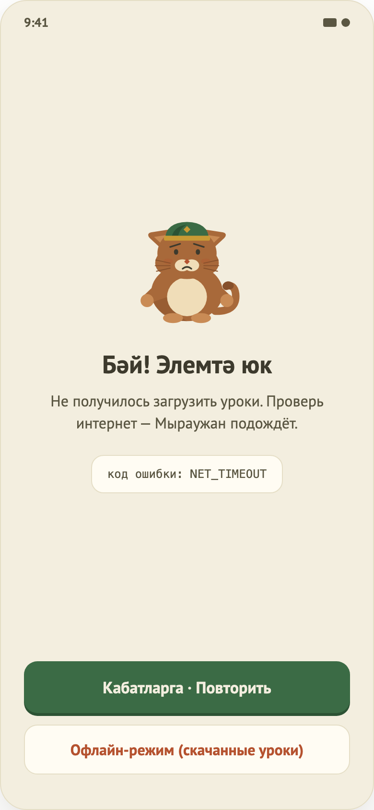

# 07–08. Загрузка и ошибка

 

## Назначение
Единый вид ожидания и сбоя для всех экранов, которые загружают данные. Это не отдельные экраны, а состояния других экранов.

## Что на экране
- **Загрузка (07):** анимация пульсирующих ромбов и текст «Мыраужан ищет твои уроки…».
- **Ошибка (08):** заголовок «Бәй! Элемтә юк», текст «Не получилось загрузить уроки. Проверь интернет — Мыраужан подождёт.», строка «код ошибки: …», кнопка «Кабатларга · Повторить» и, при необходимости, «Офлайн-режим (скачанные уроки)».

## Где используется
| Экран | Поведение |
|---|---|
| Главная | Загрузка и ошибка заменяют весь экран; «Повторить» перезапускает загрузку. |
| Урок | То же при загрузке урока. |
| Вход, Онбординг, Результат | Не используют — данных для загрузки нет. |

## Поведение
Код ошибки показывается как есть: нет связи (таймаут), ошибка сети, не найдено, неизвестная ошибка, в уроке нет упражнений.

## Ограничения
- Кнопка «Офлайн-режим» предусмотрена, но нигде не подключена — офлайн-режима нет.
- Нет иллюстрации маскота (требуется дизайн).
- Текст ошибки одинаков для любого кода; для «в уроке нет упражнений» формулировка про интернет вводит в заблуждение.
- Нет ограничения времени ожидания, нет «скелетонов».
