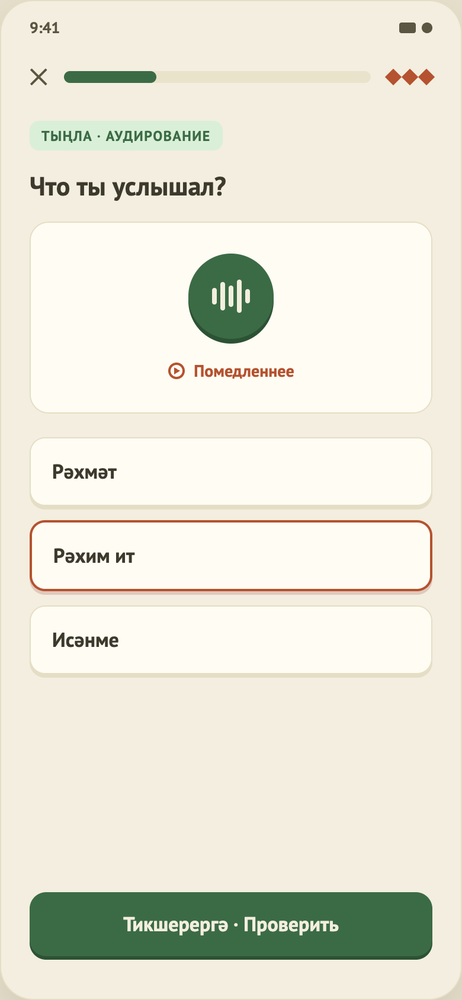

# 09. Упражнение «Аудирование»

Общая механика — в [04-lesson-matching.md](04-lesson-matching.md), часть A.

> **В MVP упражнение отключено.** Озвучки нет, поэтому шаги аудирования не включаются в урок, пока у задания нет `audioUrl` (`LessonPlanner`). Данные `listening` остаются в JSON уроков и включатся сами, когда появятся записи (`TODO(audio)`). Решение 25.10.2026 по совету методиста: без звука различение на слух не проверить; порядок возврата — звук слова по нажатию в сопоставлении и квизе, затем аудирование «звук → перевод», затем диктант.

## Назначение
Прослушать запись и выбрать, что было сказано.

## Что на экране
1. Тег «Тыңла · аудирование», заголовок «Что ты услышал?».
2. Карточка с большой кнопкой воспроизведения и ссылкой «Помедленнее».
3. Варианты ответа (без номеров).
4. Кнопка «Проверить» / панель результата.

## Поведение
- **Воспроизведение:** кнопка играет запись в обычном темпе, «Помедленнее» — медленнее (75 % скорости).
- **Пока звучит запись:** столбики «волны» на кнопке колеблются.
- **Если запись не воспроизвелась:** под ссылкой «Помедленнее» появляется подпись «Не удалось воспроизвести звук. Нажмите ещё раз.» (состояние пока не нарисовано в макете, `TODO(design)`).
- **Если записи нет:** задание в урок не попадает.
- **Остановка:** при проверке ответа, выходе и закрытии экрана.
- **Ответ:** как в квизе — выбрать вариант, нажать «Проверить». Верный подсвечивается зелёным; при ошибке выбранный красный, правильный зелёный, а в панели результата под правильным ответом короткое пояснение: перевод всех вариантов (например, «өй — дом · өч — три · әни — мама»). Нужна проверка носителем.

## Данные
Задание: ссылка на запись, варианты, номер правильного, пояснение. В каждом из 8 уроков по 2 задания, записи есть для всех 16.

## Ограничения
- Озвучены только правильные ответы заданий на слух (16 слов), записал автор проекта; нужна проверка носителем.
- Нет автозапуска звука при показе шага и счётчика прослушиваний.
- Воспроизведение на устройствах ещё не проверено вручную.
