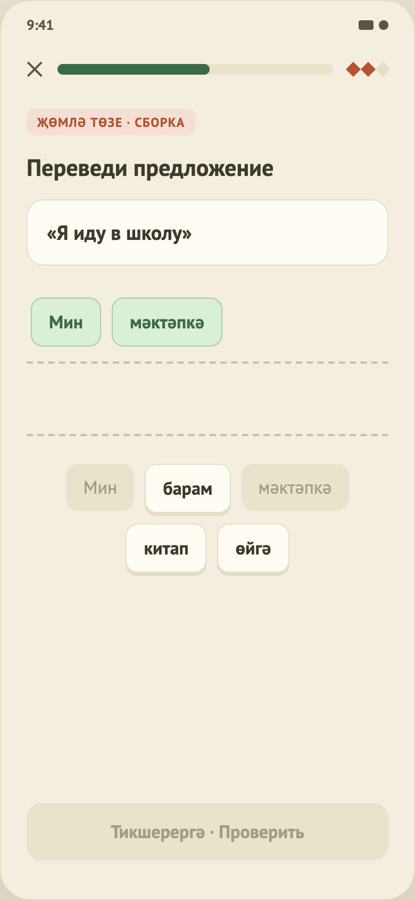

# 10. Упражнение «Сборка предложения»

Общая механика — в [04-lesson-matching.md](04-lesson-matching.md), часть A.

## Назначение
Перевести русскую фразу, составив татарское предложение из слов-плиток.

## Что на экране
1. Тег «Җөмлә төзе · сборка», заголовок «Переведи предложение».
2. Карточка с русской фразой.
3. Строка ответа, куда попадают выбранные слова (под ней вторая пустая строка — для длинных предложений, как в макете).
4. Набор слов-плиток; в нём могут быть лишние слова.
5. Кнопка «Проверить» / панель результата.

## Поведение
- **Добавить слово:** нажатие на плитку переносит слово в конец строки ответа, плитка становится неактивной.
- **Убрать слово:** нажатие на слово в строке ответа возвращает его в набор; порядок остальных слов сохраняется.
- После проверки слова менять нельзя.
- **«Проверить»** активна, когда выбрано ровно столько слов, сколько в правильном ответе.
- **Проверка:** слова должны стоять в точности в эталонном порядке. Верно — показывается предложение целиком и «+3 XP». Неверно — «Правильный ответ: …».

## Данные
Русская фраза, набор слов, эталонная последовательность. В уроке «Семья» — 2 задания.

## Ограничения
- Засчитывается **один** порядок слов; другие допустимые варианты (в татарском порядок гибкий) не поддерживаются.
- Нет перетаскивания и анимации перелёта плиток.
- Контент не проверен носителем.
