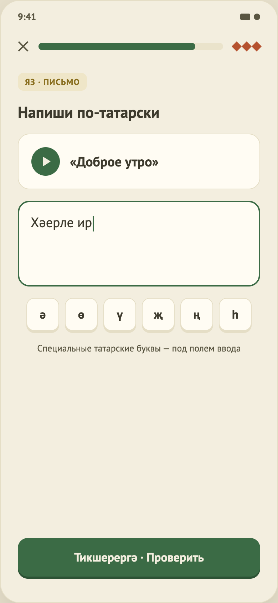

# 11. Упражнение «Письменный перевод»

Общая механика — в [04-lesson-matching.md](04-lesson-matching.md), часть A.

## Назначение
Написать перевод русской фразы по-татарски.

## Что на экране
1. Тег «Яз · письмо», заголовок «Напиши по-татарски».
2. Карточка с кнопкой прослушивания и русской фразой.
3. Многострочное поле ввода.
4. Клавиши татарских букв: **ә ө ү җ ң һ**, подпись «Специальные татарские буквы — под полем ввода».
5. Кнопка «Проверить» / панель результата.

## Поведение
- **Ввод:** «Проверить» активна, если введён непустой текст (одни пробелы не считаются).
- **Клавиши букв:** вставляют букву в место курсора (или вместо выделенного текста).
- **Прослушивание:** играет запись, если она есть; иначе имитация.
- **Проверка** не чувствительна к регистру, знакам препинания и лишним пробелам. Три исхода:
  1. **Точное совпадение** с одним из допустимых ответов — верно, «+3 XP».
  2. **Совпадение с точностью до особых букв** (например, «а» вместо «ә», «у» вместо «ү») — верно, XP начисляется, но показывается «Правильно пишется: …». Рассчитано на ввод с русской раскладки.
  3. **Иначе** — ошибка, «Правильный ответ: …» (первый из допустимых).
- После проверки поле и клавиши блокируются.

## Данные
Русская фраза, список допустимых ответов (первый — эталон для показа), ссылка на запись. В уроке «Семья» — 3 задания.

## Ограничения
- Опечатка в одну букву считается ошибкой, подсказки «почти верно» нет.
- Правила замены букв — предположение, нужна проверка носителем.
- Допускаются только заранее перечисленные варианты ответа (синонимы и другой порядок слов не учитываются).
- Используется системная клавиатура, заглавных ә, ө и т. д. среди клавиш нет.
