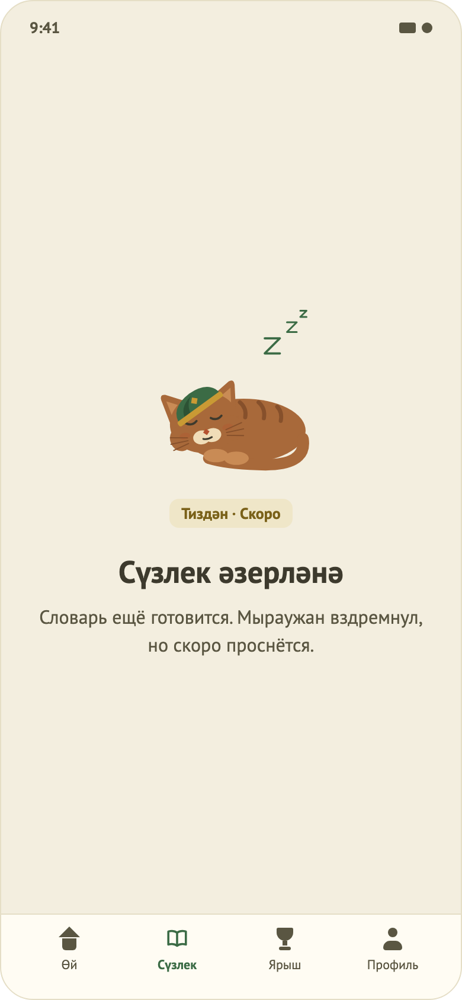

# 16. Заглушка раздела

## Назначение
Показывается на вкладках нижнего меню, которых ещё нет: «Сүзлек» (словарь), «Ярыш» (соревнования), «Профиль». Честно сообщает, что раздел готовится, и не выглядит сломанным.

## Откуда и куда
- **Откуда:** нажатие на «Сүзлек», «Ярыш» или «Профиль» в нижнем меню главной.
- **Куда:** вкладка «Өй» в нижнем меню возвращает на главную. Других выходов нет (кнопки «На главную» нет: она дублировала бы вкладку «Өй»).

## Что на экране (сверху вниз, по центру)
1. Спящий маскот Мыраужан.
2. Золотая метка «Тиздән · Скоро».
3. Заголовок раздела: «Сүзлек әзерләнә», «Ярыш әзерләнә», «Профиль әзерләнә».
4. Пояснение: «Словарь / Соревнования / Профиль ещё готовится. Мыраужан вздремнул, но скоро проснётся.»
5. Нижнее меню; выбранная вкладка подсвечена.

## Поведение
- Выбранная вкладка запоминается на время работы экрана главной; смена вкладки скрывает показанное уведомление.
- Экран одинаков для трёх вкладок, меняются только заголовок и пояснение.
- Экран прокручивается при крупном шрифте или на маленьком телефоне.

## Тексты и язык
Весь татарский текст («Тиздән · Скоро», «Сүзлек әзерләнә», «Ярыш әзерләнә», «Профиль әзерләнә») подтверждён автором проекта как носителем языка.

## Решения (аудит ux-designer)
- Выбран вариант с маскотом по центру (из четырёх черновиков). Скелетоны («призраки» контента) отвергнуты: выглядят как зависшая загрузка.
- Кнопка «На главную» убрана как дубль вкладки «Өй».

## Ограничения
- Системная кнопка «назад» с заглушки пока не возвращает на «Өй».
- В «Профиле» нет выхода из аккаунта; ux-designer советует мини-профиль (имя, почта, «Выйти» с подтверждением), решено сделать позже (планируется отдельной задачей), пока «Профиль» остаётся заглушкой.
- Тёмной темы нет (`TODO(design)`).
