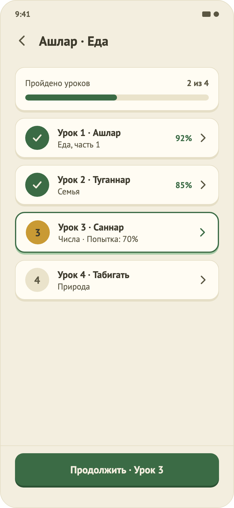
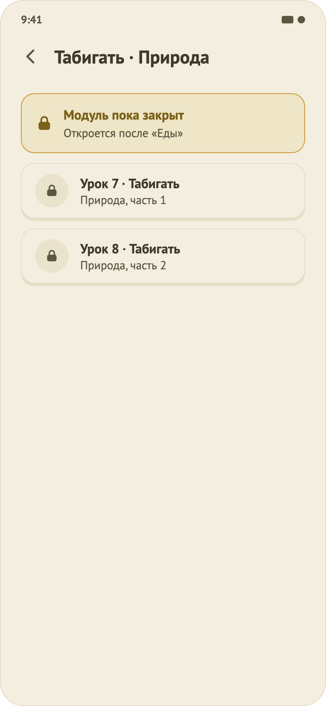
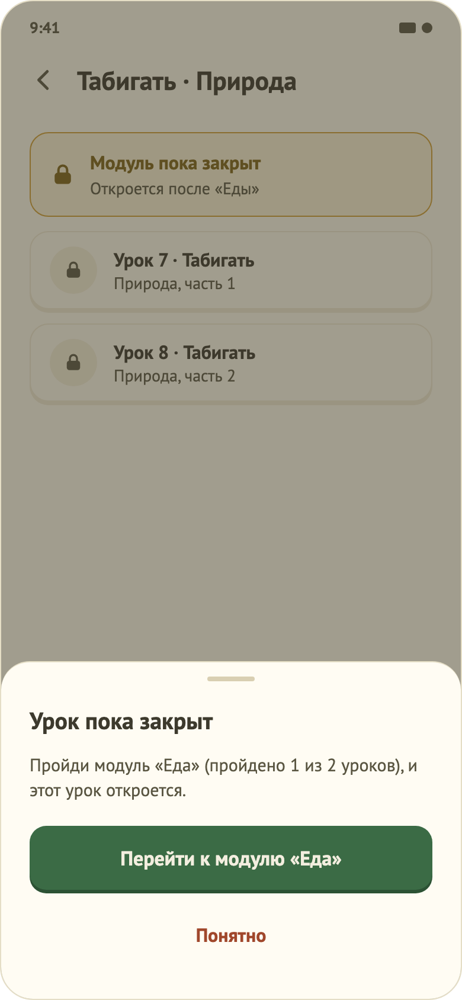
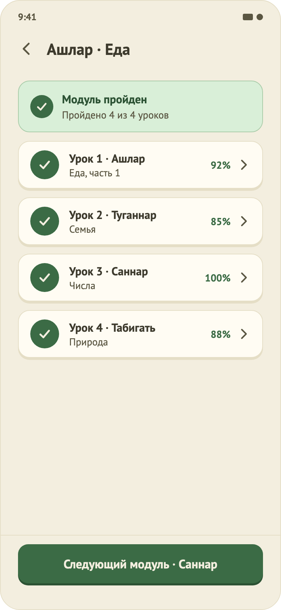

# 18. Экран модуля

   

## Назначение
Показать уроки одного модуля, их статусы и дать начать любой доступный урок. Раньше нажатие на плитку модуля на главной выдавало уведомление «пока недоступно».

## Откуда и куда
- **Откуда:** нажатие на плитку модуля на главной (открытый или закрытый); «Перейти к модулю…» из листа закрытого урока; «Следующий модуль» в пройденном модуле.
- **Куда:** урок (нажатие на строку или «Продолжить»), другой модуль, назад на главную (стрелка или системный жест).

> Оформление экрана обновлено 04.11.2026 (макеты 18–23): баннер модуля с иллюстрацией и резным краем, лента уроков с узлами-эчпочмаками и тропой из ромбов, компактная строка при прокрутке. Состав и поведение ниже прежние; подробности вида: `feature/module/CLAUDE.md`. Нажатие на закрытый модуль на главной теперь показывает тост и не открывает этот экран.

## Что на экране (сверху вниз)
1. Стрелка «назад» (шеврон, цель 48 dp) и название модуля «Татарский · Русский».
2. Открытый модуль: карточка «Пройдено уроков N из M» с полосой. Закрытый: золотой баннер с замком «Модуль пока закрыт» и подсказкой («Откроется после модуля «Ашлар · Еда»»). Пройденный: зелёный баннер «Модуль пройден».
3. Список уроков. Строка: кружок статуса, «Урок N · название», русское название, справа процент пройденного и шеврон.
   - **Пройден:** зелёный кружок с галочкой, лучший результат в процентах.
   - **Следующий** (первый непройденный): золотой кружок с номером, зелёная рамка.
   - **Не начат:** серый кружок с номером.
   - **Закрыт:** серый кружок с замком, без шеврона.
4. Закреплённая кнопка внизу: «Продолжить · Урок N» (открытый модуль) или «Следующий модуль · …» (пройденный). У закрытого модуля кнопки нет.

## Поведение
- **Порядок уроков:** в открытом модуле все уроки доступны в любом порядке, рекомендуемый только выделен.
- **Повтор:** пройденный урок можно проходить снова; статус и лучший результат не снижаются.
- **Закрытый модуль:** смотреть можно, уроки начать нельзя. Нажатие на урок открывает лист «Урок пока закрыт»: сколько уроков пройдено в предыдущем модуле, кнопка «Перейти к модулю «…»» и «Понятно».
- **Обновление:** после урока статусы и проценты обновляются сами, без перезагрузки.
- **Доступность:** статус строки читается словами («Пройден, 92 процентов», «Следующий», «Закрыт»), заголовок помечен как заголовок, цвет не единственный признак.

## Состояния
Загрузка (скелет строк, макет 21) · основное (18) · закрытый модуль (19) · закрытый урок с листом (20) · пустой модуль («Уроков пока нет», 22) · пройден целиком (23) · ошибка (общее состояние 08 с «Повторить»; «модуль не найден» тоже ошибка).

## Ограничения
- Состояний «Начат: N из M» и «Попытка: 70%» нет: урок проходится за один заход, число шагов и результат непройденной попытки не сохраняются.
- «Продолжить» на экране результата возвращает на главную, а не в модуль; кнопки «Следующий урок» там пока нет.
- Тексты статусов только русские.
- Тёмной темы нет.
