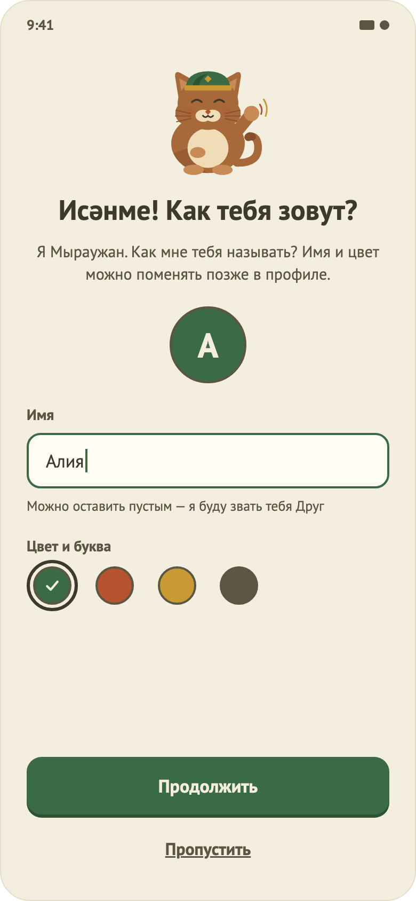
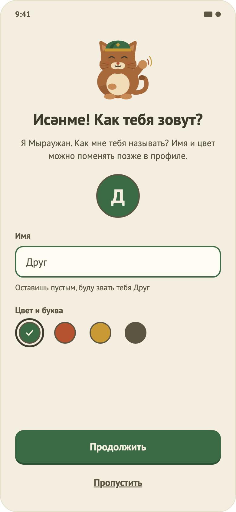
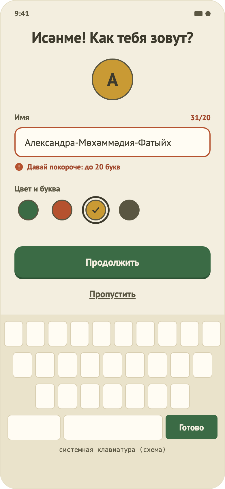

# 19. Знакомство (гостевой режим)

  

## Назначение
Пока регистрация и вход закрыты фича-флагом, пользователь представляется: вводит имя и выбирает цвет аватара. Данные хранятся на устройстве. Экран показывается один раз.

## Откуда и куда
- **Откуда:** онбординг (кнопка «Начать учиться», «Пропустить» и «✕» ведут сюда, а не на вход); запуск приложения, если онбординг уже показан, а профиля ещё нет.
- **Куда:** главная (стек заменяется, вернуться назад нельзя).

## Что на экране
1. Маскот Мыраужан (приветствует), заголовок «Исәнме! Как тебя зовут?», подпись «Я Мыраужан. Как мне тебя называть? …».
2. Превью аватара 72 dp (цвет и первая буква имени).
3. Поле «Имя» с подсказкой «Можно оставить пустым — буду звать тебя Друг», плейсхолдер «Друг»; счётчик «N/20» с 15-го символа.
4. Выбор цвета аватара: 4 цвета из токенов (зелёный, терракотовый, золотой, серо-коричневый). Выбранный виден кольцом и галочкой. Позы Мыраужана доступны позже, в профиле.
5. Кнопка «Продолжить» и ссылка «Пропустить».

## Поведение
- Пустое имя не ошибка: сохранится имя «Друг». Пробелы по краям обрезаются, повторные схлопываются.
- Имя длиннее 20 символов: терракотовое сообщение «Давай покороче: до 20 букв», «Продолжить» неактивна.
- «Пропустить»: сохраняется имя «Друг» и первый цвет; имя можно поменять позже в профиле.
- Кнопка «Готово» на клавиатуре действует как «Продолжить». При открытой клавиатуре маскот и подпись прячутся (макет 29), кнопки остаются над клавиатурой.
- Знакомство не показывается повторно: признак хранится как наличие профиля.
- Уже вошедшие пользователи (сессия с именем из e-mail) знакомство не видят: имя переносится в профиль при запуске.

## Фича-флаг
`tamyr.registrationEnabled` в `gradle.properties` (по умолчанию `false`). Флаг выключен: онбординг ведёт на знакомство, вход и регистрация недоступны. Включён: прежний поток «онбординг → вход/регистрация → главная», знакомство не показывается.

## Ограничения
- Татарский только «Исәнме!» (needs native-speaker review для остального текста).
- Юридическая часть (152-ФЗ, политика конфиденциальности, дети) не проработана: нужна проверка юриста.
- Тёмной темы нет.
