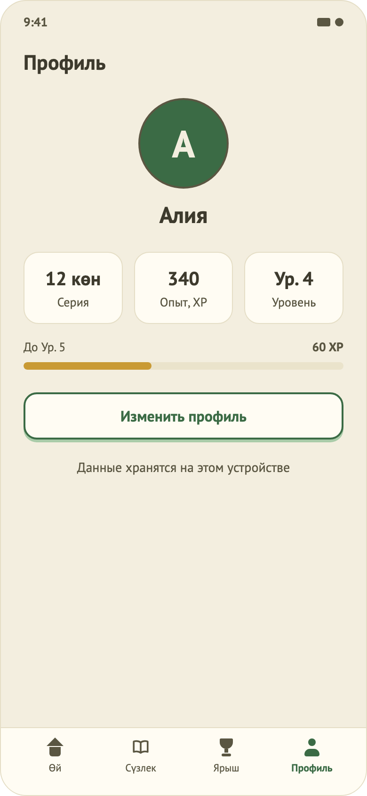
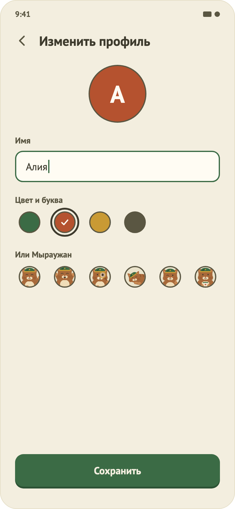
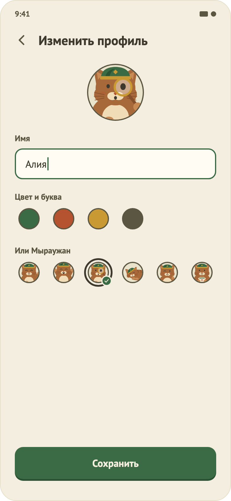
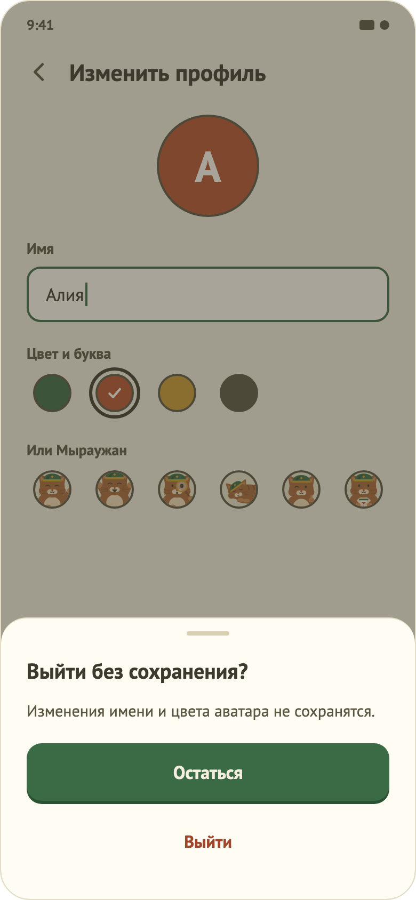

# 20. Профиль

   

## Назначение
Вкладка «Профиль» нижнего меню: показывает, кто учится (имя, аватар), и серию, XP и уровень. Здесь можно изменить имя и аватар. Данные профиля хранятся на устройстве и не уходят в сеть.

## Откуда и куда
- **Откуда:** вкладка «Профиль» главной; нажатие на аватар в шапке главной.
- **Куда:** экран изменения профиля («Изменить профиль»), назад на главную через вкладку «Өй».

## Что на экране (просмотр, макеты 26 и 33)
1. Заголовок «Профиль», аватар 96 dp (цвет с буквой или поза Мыраужана), имя.
2. Три плоские плитки: серия («N көн»), опыт (XP), уровень («Ур. N»), под ними полоса до следующего уровня («До Ур. N · M XP»).
3. Кнопка «Изменить профиль» и подпись «Данные хранятся на этом устройстве».
4. В отладочной сборке: кнопка «Инструменты отладки».
5. После сохранения профиля показывается уведомление «Сохранено».

## Изменение профиля (макеты 27, 30, 31, 32)
- Аватар-превью, поле «Имя» (счётчик «N/20» с 15-го символа), выбор аватара: 4 цвета с буквой и 6 поз Мыраужана (приветствует, радуется, с лупой, спит, одобряет, с песочными часами). Цвета и позы образуют одну группу: выбран ровно один вариант.
- «Сохранить» активна только при изменениях и допустимом имени (не пустое, до 20 символов). «Готово» на клавиатуре только закрывает её, сохранение отдельной кнопкой; тап по свободному месту тоже закрывает клавиатуру.
- После сохранения экран закрывается, на вкладке «Профиль» появляется «Сохранено», имя и аватар сразу обновляются на главной.
- Стрелка «назад» и системный жест при несохранённых изменениях открывают лист «Выйти без сохранения?» («Остаться» / «Выйти»); без изменений просто закрывают экран.

## Данные
Отдельная сущность «Профиль» (имя, аватар, локальный идентификатор UUID) в настройках приложения; сессия входа хранится отдельно. Идентификатор нужен, чтобы позже привязать профиль и прогресс к аккаунту. При отсутствии профиля (поток с входом) имя берётся из сессии.

## Доступность
Аватар в профиле декоративен (имя рядом), варианты аватара читаются описаниями («Мыраужан с лупой», «Цвет аватара: зелёный»), выбор не только цветом (кольцо и галочка), цели нажатия 48 dp, заголовки помечены.

## Ограничения
- Выхода из аккаунта, регистрации и входа нет (закрыты флагом `tamyr.registrationEnabled`).
- Цели обучения, напоминания, ежедневная цель и «Удалить данные» не реализованы.
- Новые позы Мыраужана (с книгой, с чашкой чая и др.) ждут иллюстраций.
- Татарское название вкладки «Профиль» не подтверждено.
- Юридическая часть (политика конфиденциальности, дети) не проработана: нужна проверка юриста. Тёмной темы нет.
