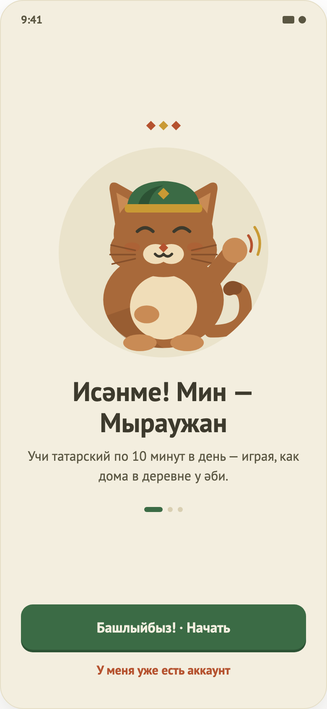

# 01. Онбординг

Макет: `design/screens/01.png`. Код: `…/feature/onboarding/` (`OnboardingContract.kt`, `OnboardingViewModel.kt`, `OnboardingScreen.kt`).

## Назначение
Первое знакомство: объяснить идею приложения тремя слайдами и отправить на регистрацию или вход. Показывается только при первом запуске.

## Вход / выход
- **Вход:** старт приложения, если нет сессии и флаг `onboarding_seen` не выставлен.
- **Выход:** «Начать» → Auth в режиме «Регистрация»; «У меня уже есть аккаунт» → Auth в режиме «Вход». В обоих случаях флаг `onboarding_seen = true`, поэтому в следующий запуск онбординг пропускается.

## Элементы UI
1. Горизонтальный pager из 3 страниц (свайп влево/вправо).
2. На каждой странице: три ромба (акцент/золото/акцент), круг-заглушка под иллюстрацию маскота (250dp), заголовок, подзаголовок, индикатор страниц (активная точка — вытянутая).
3. Внизу (общие для всех страниц): кнопка `Башлыйбыз! · Начать`, текстовая кнопка `У меня уже есть аккаунт`.

Тексты: страница 1 — «Исәнме! Мин — Мыраужан…» (есть в макете); страницы 2 и 3 («Короткие уроки каждый день», «Следи за прогрессом») придуманы, в макете их нет.

## Функционал (как работает сейчас)
| Функция | Поведение |
|---|---|
| Листание страниц | Позиция pager — чисто UI-состояние в экране (`rememberPagerState`), во ViewModel не хранится. |
| Индикатор | Точка текущей страницы шире и цвета primary; остальные — `borderStrong`. |
| «Начать» | `StartClicked` → `storage.markSeen()` → effect `NavigateToAuth(SignUp)`. |
| «Уже есть аккаунт» | `HaveAccountClicked` → `markSeen()` → effect `NavigateToAuth(SignIn)`. |
| Пропуск | Отдельной кнопки «Пропустить» нет — выйти можно только через одну из двух кнопок. |

Нюанс реализации: `OnboardingViewModel.onEvent` не разбирает события по типам: любое событие помечает онбординг виденным, а режим Auth выбирается сравнением события с `StartClicked`.

## Состояния
Только content. Загрузки/ошибок нет (экран статичный). `OnboardingUiState` — пустой `data object`.

## Не реализовано / ограничения
- Иллюстрации маскота (`TODO(design)`, круг-заглушка).
- Страницы 2 и 3 отсутствуют в макете — нужен дизайн и вычитка текста.
- Нет кнопки «Пропустить», нет кнопки «Далее» (только свайп).
- Если закрыть приложение, не нажав кнопку, флаг не выставится — онбординг покажется снова.
