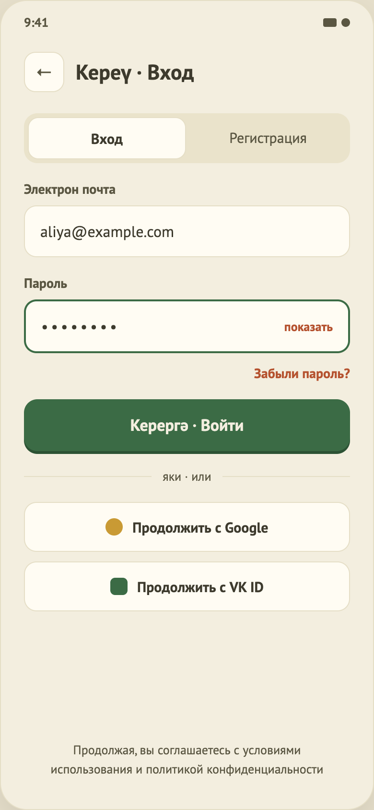

# 02. Вход / Регистрация

Макет: `design/screens/02.png`. Код: `…/feature/auth/` (`AuthContract.kt`, `AuthViewModel.kt`, `AuthValidator.kt`, `AuthScene.kt`, `AuthContent.kt`), `…/data/fake/FakeRepositories.kt` (`FakeAuthRepository`), `…/data/local/SessionStorage.kt`.

## Назначение
Войти или создать аккаунт по e-mail и паролю (или «через соцсеть»), после чего попасть на главную.

## Вход / выход
- **Вход:** из Онбординга (режим зависит от кнопки) или со старта приложения (если онбординг уже виден, режим «Вход»).
- **Выход:** успех → Home со сбросом стека (назад на Auth не вернуться); кнопка «←» → возврат на предыдущий экран.

## Элементы UI
1. Шапка: кнопка «←» (40dp) и заголовок («Кереү · Вход» / «Теркәлү · Регистрация»).
2. Переключатель вкладок `Вход | Регистрация`.
3. Поле «Электрон почта» (клавиатура e-mail) с текстом ошибки.
4. Поле «Пароль» (маскирование `•`) с ссылкой «показать/скрыть» справа и текстом ошибки.
5. «Забыли пароль?» — только в режиме входа.
6. Главная кнопка: «Керергә · Войти» / «Теркәлергә · Зарегистрироваться».
7. Строка с кодом ошибки запроса (если есть).
8. Разделитель «яки · или».
9. Кнопки «Продолжить с Google» и «Продолжить с VK ID» (цветные метки вместо логотипов).
10. Юридическая сноска внизу.

Экран прокручивается и учитывает клавиатуру (`imePadding`).

## Функционал (как работает сейчас)
| Функция | Поведение |
|---|---|
| Переключение режима | Вкладки меняют `mode`; сбрасывают ошибки полей и ошибку запроса. Введённые email/пароль сохраняются. Заголовок и текст кнопки меняются. |
| Ввод e-mail / пароля | Обновляет значение и снимает ошибку этого поля и ошибку запроса. |
| Показать/скрыть пароль | Переключает `passwordVisible`. |
| Валидация (`AuthValidator`) | E-mail: пустой → «Введите электронную почту»; не подходит под `^[^@\s]+@[^@\s]+\.[^@\s]+$` → «Проверьте адрес…». Пароль: меньше 6 символов → «Пароль — не меньше 6 символов». Намеренно лёгкая проверка, реальная — на бэкенде. |
| Отправка | Если уже идёт запрос — игнор. При ошибках валидации они показываются, запрос не уходит. Иначе вход (`signIn`) или регистрация (`signUp`) с `email.trim()`. Во время запроса кнопка отключена. |
| Успех | `isSubmitting=false`, effect `NavigateToHome`. |
| Ошибка запроса | Текст «Не получилось войти. Код ошибки: …» (код из `AppException`). Текст одинаков для входа и регистрации. |
| Соцвход (Google/VK) | **Заглушка:** репозиторий не вызывается, в `uiState.toast` ставится `AuthToast.SocialUnavailable`. `TODO(backend)`: настоящий OAuth. |
| Уведомление (`TamyrToast`) | `AuthViewModel` держит `toastJob`: показ → `delay(TamyrMotion.TOAST_VISIBLE_MS)` (5 с) → `toast = null`. Новое уведомление отменяет предыдущий таймер и заменяет текст. `ToastDismissed` (крестик/свайп вверх) сразу скрывает. |
| «←» | effect `NavigateBack` (если Auth — корень стека, действие ничего не делает). |
| «Забыли пароль?» | Просто текст, не кликабелен (`TODO(design)`). |

### Что делает fake-бэкенд
`FakeAuthRepository` принимает **любые** данные (и для входа, и для регистрации), ждёт 300–800 мс, имя берёт из e-mail до `@` с заглавной буквы (`aliya@…` → «Aliya»), сохраняет сессию в `SessionStorage` (переживает перезапуск). При включённых «ошибках сети» отвечает `NET_TIMEOUT`.
`signOut()` в репозитории есть, но в UI нигде не вызывается.

## Состояния
- Ввод: чистая форма.
- Ошибка поля: текст под полем (стиль ошибки поля — `TODO(design)`, нет в макете).
- Отправка: кнопка disabled (индикатора загрузки нет).
- Ошибка запроса: акцентный текст под кнопкой.

## Не реализовано / ограничения
- Реального бэкенда/OAuth нет, пароль нигде не проверяется и не хранится.
- Нет экрана «Забыли пароль», нет проверки «пользователь уже существует» (fake принимает всё).
- Нет отдельного текста ошибки для неверных данных и для регистрации.
- Токен не хранится (когда появится — Keychain / EncryptedSharedPreferences).
- Нет подтверждения пароля, согласия с условиями (только сноска без ссылок).
- Нет выхода из аккаунта в UI.
