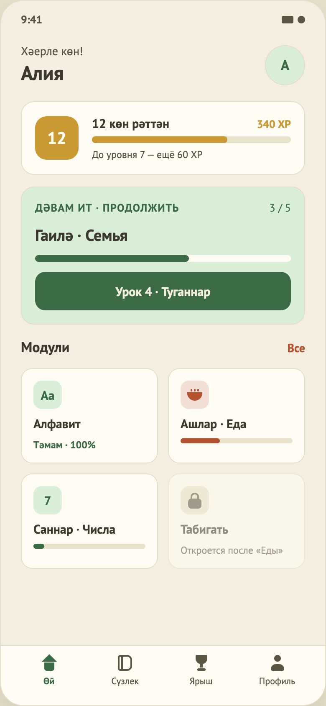

# 03. Главная

Макет: `design/screens/03.png`. Код: `…/feature/home/` (`HomeContract.kt`, `HomeViewModel.kt`, `HomeScene.kt`, `HomeContent.kt`, иконки `*NavIcon.kt`, `BowlIcon.kt`, `LockIcon.kt`), данные — `home.json`, `UserStats`.

## Назначение
Центр приложения: приветствие, серия и XP, карточка «продолжить урок», список модулей, нижняя навигация.

## Вход / выход
- **Вход:** старт с сессией; успешный вход; «Продолжить» на Result.
- **Выход:** «Урок N · …» → Lesson(`currentLesson.lesson.id`).

## Элементы UI (сверху вниз, скролл)
1. **Шапка:** «Хәерле көн!», имя пользователя; справа круглый аватар с первой буквой имени.
2. **Карточка «Дәвам ит · Продолжить»** (главное действие экрана): тег, «выполнено / всего», тема «Гаилә · Семья», прогресс-бар, кнопка «Урок 4 · Туганнар».
3. **Компактная карточка серии:** бейдж серии 40dp, «Серия: N көн», «Ур. L · N XP», тонкий прогресс-бар до следующего уровня (подпись «До уровня…» убрана).
4. **Заголовок «Модули»** и ссылка «Все» (показывает уведомление-заглушку).
5. **Сетка модулей 2 колонки** (плитки).
6. **Нижняя панель:** Өй, Сүзлек, Ярыш, Профиль.

## Функционал (как работает сейчас)
| Функция | Поведение |
|---|---|
| Загрузка | При открытии `lessons.getHome()` (300–800 мс) → `LoadState`. Пока грузится — экран загрузки (07), при ошибке — экран ошибки (08) с кнопкой «Повторить» (`RetryClicked` перезагружает). |
| Имя | Берётся из сессии (`auth.session`), обновляется реактивно. Аватар — первая буква заглавной. |
| Серия и XP | Подписка на `progress.observeStats()` (БД) — обновляется «вживую», не зависит от запроса главной. XP-бар: `(100 − xpToNextLevel)/100`. Уровень = `xp/100+1`. |
| Карточка текущего урока | Данные `currentLesson` из `home.json`. Прогресс-бар = `completed/total`. Кнопка → `StartLessonClicked` → effect `NavigateToLesson`; срабатывает только когда контент загружен. |
| Плитка модуля | Чип с иконкой по ключу `icon` (`alphabet` → «Аа», `numbers` → «7», `food` → миска, прочее → первая буква названия). Название «Тат · Рус» (если названия совпадают — одно). |
| Состояния плитки | **Закрыт** (`lockedBy != null`): светло-бежевая плитка без прозрачности, иконка замка, только татарское название, подсказка (`lockHint`, напр. «Откроется после «Еды»»). **Пройден** (≥100 %): текст «Тәмам · 100%». **В процессе**: прогресс-бар (для `food` цвет акцента, иначе primary). |
| Клик по модулю | Закрытый: уведомление с его подсказкой (`lockHint`, иначе «Модуль пока закрыт»). Открытый: «Экран модуля пока недоступен» (`TODO(design)`: экрана модуля нет). |
| «Все» | Уведомление «Список модулей пока недоступен». |
| Нижняя панель | Активна только «Өй». «Сүзлек», «Ярыш», «Профиль» переключают `HomeUiState.tab` и показывают `ComingSoonState` (экран 16, `core/designsystem/component`) над нижней панелью. Иконки — упрощённые аппроксимации (`TODO(design)`). |
| Уведомления | `uiState.toast` + `AutoDismiss` (5 с), замена старого, крестик и свайп вверх (общий `TamyrToastHost`). |

### Тестовые данные (`home.json`)
Модули: Алфавит 100 %, Ашлар/Еда 35 %, Саннар/Числа 10 %, Табигать/Природа 0 % (закрыт, ждёт «Еду»). Текущий урок: `lesson_4` «Туганнар / Семья», 3 из 5.

## Состояния
Loading (07) / Content / Error (08, с `onOffline` не передаётся — кнопки офлайн нет).

## Не реализовано / ограничения
- **Прогресс на главной статичен:** «3/5» и проценты модулей берутся из JSON, а не из БД (`LessonProgress`) — после прохождения урока они не меняются. Меняются только серия и XP.
- Нет экранов модуля, «Все модули», словаря, соревнований, профиля (вместо них уведомление-заглушка); нет выхода из аккаунта.
- Нет приветствия по времени суток (фраза «Хәерле көн!» фиксированная).
- Нет pull-to-refresh; перезагрузка только при ошибке или при повторном входе на экран.
