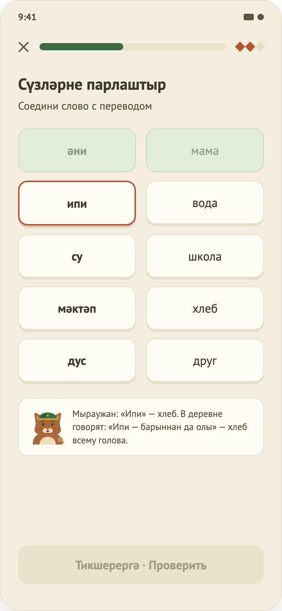

# 04. Урок: общий каркас + «Сопоставление»

Макет: `design/screens/04.png`. Код: `…/feature/lesson/` (`LessonContract.kt`, `LessonViewModel.kt`, `LessonScreen.kt`, `MatchingContent.kt`), `…/domain/exercise/LessonPlanner.kt`, `ExerciseStep.kt`.

> Этот документ также описывает **общий каркас всех упражнений** — остальные документы (05, 09, 10, 11) ссылаются на него.

# Часть A. Общий каркас урока

## Назначение
Один маршрут `LessonKey(lessonId, stepIds)` и один `LessonViewModel` проводят пользователя через весь урок: шаг за шагом, с проверкой, XP и итогом.

## Вход / выход
- **Вход:** Home (весь урок) или Result «Повторить ошибки» (только указанные `stepIds`).
- **Выход:** после последнего шага → Result (экран урока заменяется результатом). Закрытие → подтверждение → возврат назад.

## Состав урока (`LessonPlanner`)
Порядок шагов: **1 сопоставление → квизы → аудирования → сборки предложений → письменные переводы**. Id шагов стабильны: `matching`, `quiz-0…`, `listening-0…`, `sentence-0…`, `translation-0…`. Если передан `stepIds`, остаются только эти шаги (режим «повторить ошибки»). Если шагов нет — ошибка `NO_EXERCISES`.
В `lesson_4.json` это 12 шагов: 1 + 4 квиза + 2 аудирования + 2 сборки + 3 перевода.

## Рамка экрана (`ExerciseFrame`)
1. **Хедер:** кнопка ✕, прогресс-бар урока.
2. **Контент шага** (скроллится). Смена шага — анимация: новый слайдит справа + fade.
3. **Футер:** кнопка «Тикшерергә · Проверить» (неактивна, пока нет ответа) → после проверки панель, выезжающая снизу.
   - Верно: зелёная панель «Дөрес! · Верно!», деталь, кнопка «Дәвам итәргә».
   - Неверно: терракотовая панель «Ялгыш · Ошибка», «Правильный ответ: …», кнопка «Аңладым · Понятно».

Прогресс-бар = `(номер шага + 1, если шаг проверен) / всего шагов`.

## Жизненный цикл и правила
| Событие | Поведение |
|---|---|
| Загрузка | `Loading` → контент урока; ошибка → экран ошибки с «Повторить» (`RetryClicked`). Засекается время начала. |
| Проверка шага | Считается верно/неверно, формируется `StepFeedback`, шаг записывается в БД (`recordExerciseResult`), добавляется XP (3 за верный), обновляется серия дней, статус урока `InProgress`. |
| Неверный ответ | Шаг попадает в список ошибок. |
| «Продолжить» | Если шаг не последний → следующий шаг (поле ввода сбрасывается). Иначе → завершение. |
| Завершение | Точность = верных / проверенных; если точность >= 80 % — `completeLesson` (статус Completed, лучший процент); время в секундах; переход в Result с XP, точностью, временем и списком ошибочных шагов. |
| Закрыть (✕ или системное «Назад») | Диалог «Выйти из урока?» — «Выйти» / «Остаться». Текст: проверенные ответы и XP сохранятся. «Выйти» останавливает аудио и возвращается назад без Result. |
| Аудио | `PlayAudioClicked(slow)`: скорость 1.0 или 0.75. Если `audioUrl` нет — заглушка «играет» 1.2 с. Остановка при проверке шага, выходе и закрытии экрана. |

## Состояния
`Loading` / `Content` / `Error(код)`. Диалог выхода — флаг `showExitDialog`. Кнопка «Проверить» активна, когда: выбран вариант (квиз/аудирование), собрано нужное число слов (сборка), введён непустой текст (перевод). У сопоставления кнопка не нужна.

---

# Часть B. Упражнение «Сопоставление» (экран 04)

## Назначение
Соединить татарские слова с русскими переводами.

## Элементы UI
Заголовок «Сүзләрне парлаштыр», подпись «Соедини слово с переводом». Две колонки по 5 плиток (58dp): слева татарские слова в порядке урока, справа переводы в **фиксированной перемешанной** последовательности. Под плитками — карточка-подсказка маскота (если есть).

## Функционал (как работает сейчас)
| Функция | Поведение |
|---|---|
| Выбор слова слева | Тап выделяет слово (`Selected`); повторный тап снимает выделение. Уже сопоставленные и во время вспышки ошибки не нажимаются. |
| Выбор перевода справа | Работает только если слово слева выбрано. Верная пара → обе плитки `Matched` (приглушённо-зелёные), выделение снимается. Неверная → плитки на 700 мс подсвечиваются красным, счётчик ошибок шага +1. |
| Завершение шага | Когда сопоставлены все пары: шаг сразу засчитывается и открывается панель «Верно». Шаг считается верным (+XP) только если за него **не было ни одной ошибки**; иначе шаг попадает в «ошибки», XP 0. |
| Подсказка маскота | При выбранном татарском слове, для которого есть `notes[слово]`, появляется карточка (в данных: «ипи» — «Ипи — барыннан да олы…»). Картинки маскота нет (`TODO(design)`). |
| Порядок справа | Детерминированный shuffle от содержимого пар (не меняется при перерисовке и пересоздании процесса); гарантированно не совпадает с левой колонкой. |

В отличие от других упражнений, кнопка «Проверить» не используется: шаг завершается, когда найдены все пары.

## Не реализовано / ограничения
- Картинка маскота у подсказки; звук при выборе слова.
- Все пары и подсказки — тестовый контент без проверки носителем.
- Нет разделения «ошибся 1 раз / 5 раз» в XP: шаг либо верный, либо нет.
