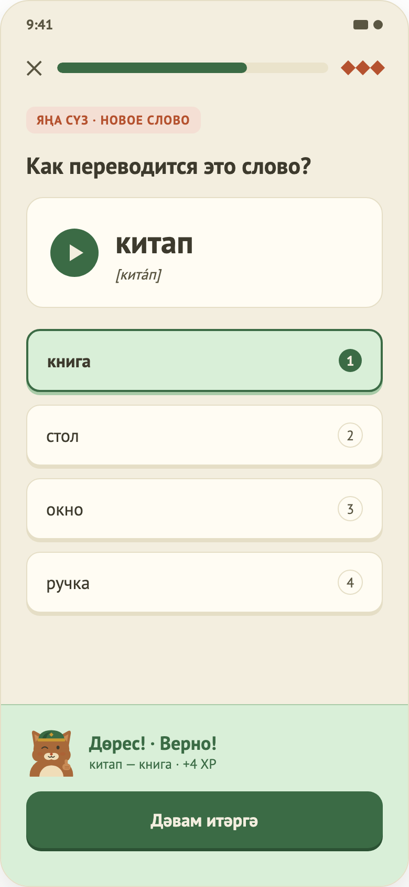

# 05. Упражнение «Квиз» (перевод слова)

Макет: `design/screens/05.png`. Код: `…/feature/lesson/QuizContent.kt`, логика — `LessonViewModel.check()`. Общий каркас, XP и выход — в [04-lesson-matching.md](04-lesson-matching.md), часть A.

## Назначение
Показать татарское слово и выбрать правильный русский перевод из вариантов.

## Элементы UI
1. Тег «Яңа сүз · новое слово» (терракотовый, цвет текста `accentText`) — только если `isNewWord = true`.
2. Заголовок «Как переводится это слово?».
3. Карточка слова: круглая кнопка воспроизведения, слово крупно, транскрипция (если есть).
4. Список вариантов ответа; у каждого бейдж с номером 1, 2, 3…
5. Футер (Проверить / панель результата).

## Функционал (как работает сейчас)
| Функция | Поведение |
|---|---|
| Выбор варианта | `OptionSelected(index)` — вариант подсвечивается; можно менять выбор до проверки. После проверки варианты заблокированы. |
| Проверка | Кнопка активна только при выбранном варианте. Верно, если `selected == correctIndex`. |
| Верный ответ | Выбранный вариант зелёный. Панель «Дөрес!», в детали «слово — перевод» и «+3 XP». |
| Неверный ответ | Выбранный — красный, правильный — зелёный. Панель «Ялгыш», «Правильный ответ: …». шаг в списке ошибок. |
| Прослушать слово | Кнопка play запускает `PlayAudioClicked`. Для квиза записей нет → играет заглушка (`TODO(audio)`). |
| Состояние вариантов | Общая функция `choiceState` (используется и в аудировании): до проверки — Selected/Neutral; после — Correct/Wrong/Neutral. |

## Данные
`quiz[]` в JSON урока: `word`, `transcription`, `options[]`, `correctIndex`, `isNewWord`. В `lesson_4.json` — 4 вопроса.

## Не реализовано / ограничения
- Нет реальных аудиозаписей слов.
- Нет перемешивания вариантов (порядок задан в данных).
- Транскрипция опциональна и не проверена носителем.
