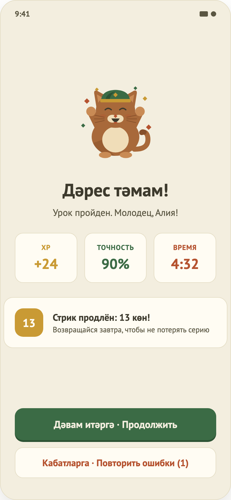

# 06. Результат урока

Макет: `design/screens/06.png`. Код: `…/feature/result/` (`ResultContract.kt`, `ResultViewModel.kt`, `ResultScreen.kt`), ключ `ResultKey` в `Routes.kt`.

## Назначение
Подвести итог урока: XP, точность, время, серия дней; предложить продолжить или повторить ошибки.

## Вход / выход
- **Вход:** от Lesson. Все цифры приходят в `ResultKey` (`lessonId`, `xpEarned`, `accuracyPercent`, `durationSeconds`, `mistakeStepIds`).
- **Выход:** «Продолжить» → Home (стек очищен); «Повторить ошибки (N)» → Lesson только с ошибочными шагами (Result остаётся под ним в стеке).

## Элементы UI
1. Заголовок «Дәрес тәмам!» и подпись «Урок пройден. Молодец, {имя}!» (если имени нет — «друг»).
2. Три плитки: **XP** (`+N`, золотой), **Точность** (`N%`, зелёный), **Время** (`m:ss`, терракотовый).
3. Карточка серии «Стрик продлён: N көн!» + «Возвращайся завтра…» — показывается только если серия > 0.
4. Кнопки: «Дәвам итәргә · Продолжить»; «Кабатларга · Повторить ошибки (N)» — только если ошибки есть.

## Функционал (как работает сейчас)
| Функция | Поведение |
|---|---|
| Показ итогов | Состояние инициализируется из `ResultKey`, ничего не грузит. |
| Серия | Подписка на `progress.observeStats()`, поле `streak` обновляется из БД; 0 скрывает карточку. |
| Формат времени | `m:ss`, секунды добиваются нулём в коде (Compose Resources не поддерживает `%02d`). |
| Продолжить | `ContinueClicked` → `NavigateHome` → `resetTo(HomeKey)`. |
| Повторить ошибки | `RetryMistakesClicked` → `NavigateToMistakes(lessonId, mistakeStepIds)` → новый Lesson только с этими шагами. Счётчики начинаются заново; XP за верные шаги начисляется снова. |
| Назад | Системного поведения не переопределено: Result — после замены Lesson, назад вернёт на предыдущий экран стека (Home). |

## Состояния
Только content (данные передаются готовыми).

## Не реализовано / ограничения
- Нет маскота над заголовком (`TODO(design)`).
- Заголовок не меняется, если точность ниже 80 %: экран по-прежнему говорит «Урок пройден», хотя урок не засчитан. Стоит добавить отдельный вариант.
- Нет анимаций XP/счётчиков, нет шеринга, нет «следующий урок».
- Повторный проход ошибок засчитывается как новая попытка в тех же счётчиках XP; отдельной статистики «ошибки» нет.
