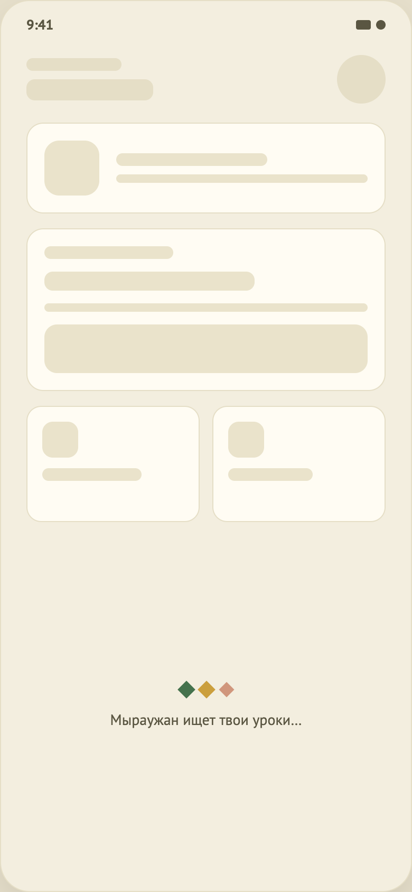
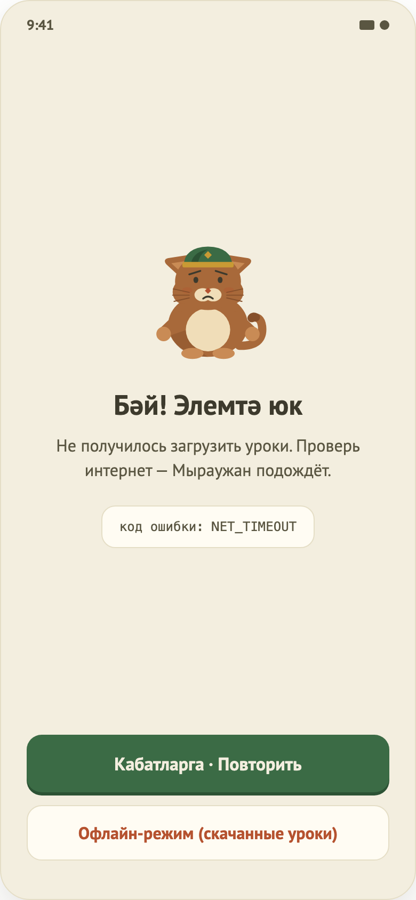

# 07–08. Загрузка и ошибка (общие состояния)

Макеты: `design/screens/07.png` (загрузка), `08.png` (ошибка). Код: `…/core/designsystem/component/StateScreens.kt`, `…/core/common/LoadState.kt`, `AppError.kt`.

 

## Назначение
Единый вид ожидания и сбоя для всех экранов с данными. Это **не маршруты**, а компоненты поверх `LoadState<T> = Loading | Content(data) | Error(code)`.

## Компоненты
- `LoadingState` — анимация пульсирующих ромбов (`PulsingDiamonds`) и текст «Мыраужан ищет твои уроки…».
- `ErrorState(code, onRetry, onOffline?)` — заголовок «Бәй! Элемтә юк», сообщение «Не получилось загрузить уроки. Проверь интернет — Мыраужан подождёт.», строка «код ошибки: …», кнопка «Кабатларга · Повторить», опционально «Офлайн-режим (скачанные уроки)».
- `LoadStateContent(state, onRetry, …) { data -> … }` — выбирает компонент по состоянию.

## Где используются
| Экран | Как |
|---|---|
| Home | `LoadStateContent` вокруг всей главной; Retry перезагружает `getModules()`. |
| Lesson | `when(load)`: Loading / Error / рамка упражнения; Retry → `load()`. |
| Auth, Onboarding, Result | не используют (нет начальной загрузки). |

## Функционал
- Код ошибки показывается пользователю как есть (`NET_TIMEOUT`, `NET_ERROR`, `NOT_FOUND`, `UNKNOWN`, `NO_EXERCISES`).
- Для проверки на устройстве: в debug UI kit переключатель «Ошибки сети» включает `FakeBackendConfig.simulateErrors` → все запросы fake-репозиториев падают с `NET_TIMEOUT`.

## Не реализовано / ограничения
- Кнопка «Офлайн-режим» поддерживается компонентом, но ни один экран её не передаёт (оффлайн-режима нет).
- Иллюстрация маскота — слот `illustration`, не заполнен (`TODO(design)`).
- Тексты ошибки одинаковы для любого кода (нет различия «нет сети» / «не найдено» / «пустой урок»); для `NO_EXERCISES` формулировка про интернет вводит в заблуждение.
- Нет таймаута у Loading, нет скелетонов.
