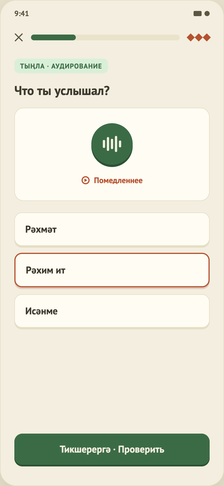

# 09. Упражнение «Аудирование»

Макет: `design/screens/09.png`. Код: `…/feature/lesson/ListeningContent.kt`, `…/core/audio/AudioPlayer.kt`, платформенные `PlatformAudioPlayer.android.kt` / `.ios.kt`. Общий каркас — в [04-lesson-matching.md](04-lesson-matching.md), часть A.

## Назначение
Послушать запись и выбрать, что было сказано.

## Элементы UI
1. Тег «Тыңла · аудирование», заголовок «Что ты услышал?».
2. Карточка с большой кнопкой воспроизведения с «волной» (`WavePlayButton`) и ссылкой «Помедленнее».
3. Варианты ответа (жирный текст, без номеров).
4. Футер.

## Функционал (как работает сейчас)
| Функция | Поведение |
|---|---|
| Воспроизведение | `PlayAudioClicked()` → `StubbingAudioPlayer.play(audioUrl, 1.0)`. |
| «Помедленнее» | `PlayAudioClicked(slow = true)` → скорость 0.75. |
| Состояние плеера | `AudioPlayerState` (`Idle / Playing / Completed / Error`) прокидывается в `LessonUiState.audio` (кнопка может реагировать на воспроизведение). |
| Нет `audioUrl` | Плеер-заглушка «играет» 1.2 с (делится на скорость) без звука. `TODO(audio)`. |
| Есть `audioUrl` | Android — `MediaPlayer`, iOS — `AVPlayer` (в симуляторе реальных URL пока нет). |
| Остановка | При проверке ответа, подтверждении выхода и закрытии экрана (`player.release()`). |
| Выбор / проверка | Как в квизе: выбрать вариант → «Проверить»; верный — зелёный; неверный — красный + правильный зелёным. Деталь верного ответа — сам вариант. |

## Данные
`listening[]`: `audioUrl` (сейчас `null`), `options[]`, `correctIndex`. В `lesson_4.json` — 2 задания.

## Не реализовано / ограничения
- **Нет ни одной аудиозаписи** — по факту упражнение проверяет угадывание без звука.
- Нет автовоспроизведения при показе шага, нет счётчика прослушиваний, нет обработки ошибки воспроизведения (iOS: `TODO(audio)` — наблюдение за ошибками `AVPlayerItem`).
- Проверить iOS-часть: запустить симулятор, открыть урок, нажать play с URL (`expect/actual` — комментарий в `PlatformAudioPlayer.ios.kt`).
