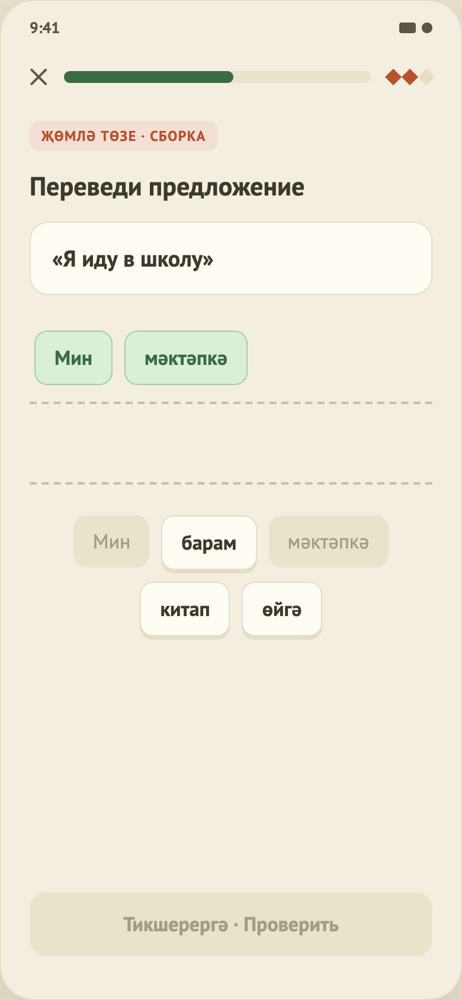

# 10. Упражнение «Сборка предложения»

Макет: `design/screens/10.png`. Код: `…/feature/lesson/SentenceContent.kt`, `WordChip`, логика — `LessonViewModel` (`onBankWord`, `onPlacedWord`, `check`). Общий каркас — в [04-lesson-matching.md](04-lesson-matching.md), часть A.

## Назначение
Перевести русскую фразу, составив татарское предложение из слов-плиток.

## Элементы UI
1. Тег «Җөмлә төзе · сборка» (терракотовый), заголовок «Переведи предложение».
2. Карточка с русской фразой в кавычках «…».
3. Область ответа: линия с пунктирным подчёркиванием, куда попадают выбранные слова; под ней вторая пустая пунктирная линия (как в макете, для длинных предложений).
4. Банк слов — плитки по центру, с переносом.
5. Футер.

## Функционал (как работает сейчас)
| Функция | Поведение |
|---|---|
| Добавить слово | Тап по слову в банке → оно появляется в конце строки ответа, плитка в банке становится «использованной» (неактивной). Повторный тап по использованной — игнор. |
| Убрать слово | Тап по слову в строке ответа → оно удаляется, плитка в банке снова доступна. Порядок остальных сохраняется. |
| Блокировка | После проверки слова нельзя менять. |
| Кнопка «Проверить» | Активна, когда выбрано **ровно столько слов, сколько в правильном ответе** (`answer.size`). |
| Проверка | Список выбранных слов сравнивается с `answer` **строго по порядку**. Верно — деталь: предложение целиком + «+3 XP». Неверно — «Правильный ответ: …». |

## Данные
`sentences[]`: `promptRu`, `wordBank[]` (может содержать лишние слова-«отвлекатели»), `answer[]` — эталонная последовательность. В `lesson_4.json` — 2 задания.

## Не реализовано / ограничения
- Допускается **один** порядок слов; альтернативные верные варианты (татарский порядок гибкий) не поддержаны.
- Перетаскивания нет (только тап), анимации перелёта плиток нет.
- Если в банке дубли одинаковых слов, сравнение идёт по тексту, а не по индексам — это допустимо, но не протестировано на таких данных.
- Контент не проверен носителем.
