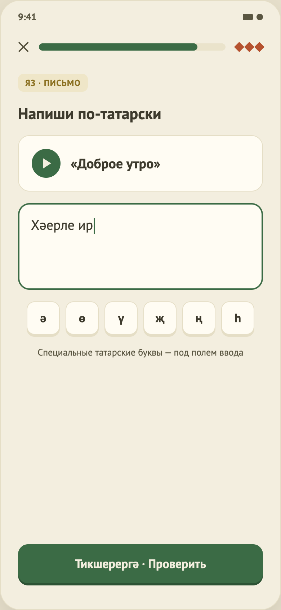

# 11. Упражнение «Письменный перевод»

Макет: `design/screens/11.png`. Код: `…/feature/lesson/TranslationContent.kt`, `…/domain/exercise/AnswerNormalizer.kt`, логика — `LessonViewModel` (`onLetter`, `check`). Общий каркас — в [04-lesson-matching.md](04-lesson-matching.md), часть A.

## Назначение
Написать перевод русской фразы по-татарски с клавиатуры.

## Элементы UI
1. Тег «Яз · письмо» (золотой), заголовок «Напиши по-татарски».
2. Карточка с кнопкой воспроизведения (40dp) и русской фразой в кавычках.
3. Многострочное поле ввода (мин. высота 120dp, крупный шрифт).
4. Ряд клавиш татарских букв: **ә ө ү җ ң һ**.
5. Подпись «Специальные татарские буквы — под полем ввода».
6. Футер.

## Функционал (как работает сейчас)
| Функция | Поведение |
|---|---|
| Ввод текста | `TextChanged` обновляет значение (до проверки). Кнопка «Проверить» активна при непустом (не только пробелы) тексте. |
| Клавиши букв | Вставляют символ **в позицию курсора / вместо выделения**; курсор ставится после вставленной буквы. Список букв берётся из строки `translation_letters`. |
| Прослушать | Кнопка play: если у задания есть `audioUrl` — играет, иначе заглушка (`TODO(audio)`). |
| Проверка (`AnswerNormalizer.check`) | 1) нормализация: нижний регистр, удаление знаков препинания (`. , ! ? ; : " ' « » “ ” „ ( ) … - – —`), схлопывание пробелов; 2) совпадение с любым из `acceptedAnswers` → **Exact**; 3) иначе сравнение после «свёртки» букв (ә→а, э→а, ө→о, ү→у, җ→ж, ң→н, һ→х, ё→е) → **Approximate**; иначе **Wrong**. Пустой ввод — Wrong. |
| Exact | Верно, деталь — эталонный ответ, «+3 XP». |
| Approximate | Верно (XP начисляется), но показывается «Правильно пишется: …» — для тех, кто набирал на русской раскладке. |
| Wrong | Ошибка, «Правильный ответ: {первый из acceptedAnswers}». |
| После проверки | Поле и клавиши букв блокируются. |

## Данные
`translations[]`: `promptRu`, `acceptedAnswers[]` (первый — эталон для показа), `audioUrl`. В `lesson_4.json` — 3 задания.

## Не реализовано / ограничения
- Нет частичной проверки/подсказки «почти верно» (опечатка в одну букву = ошибка).
- Правила свёртки букв — предположение, нужна проверка носителем (`TODO(content)` в `AnswerNormalizer`).
- Нет учёта порядка слов и синонимов, кроме явно перечисленных `acceptedAnswers`.
- Клавиатура: используется системная, своей татарской раскладки нет; заглавные буквы (Ә и т. д.) не добавляются — есть только строчные клавиши.
